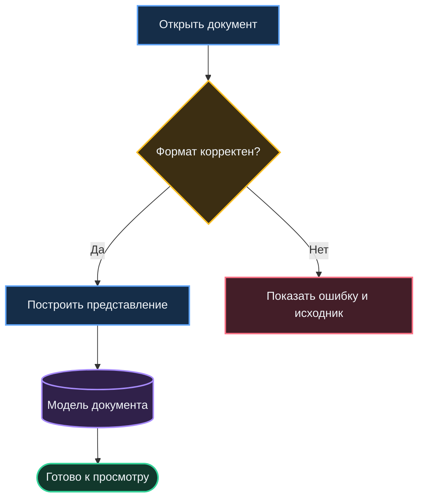
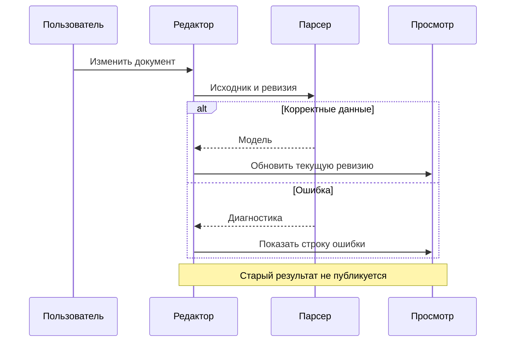
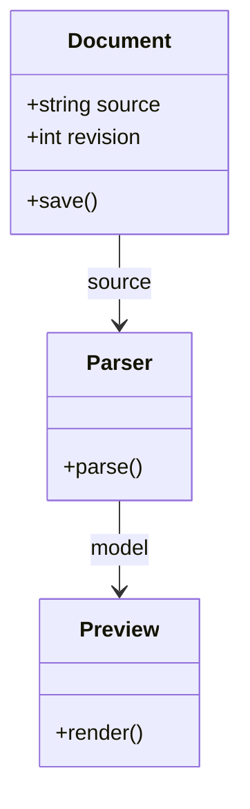
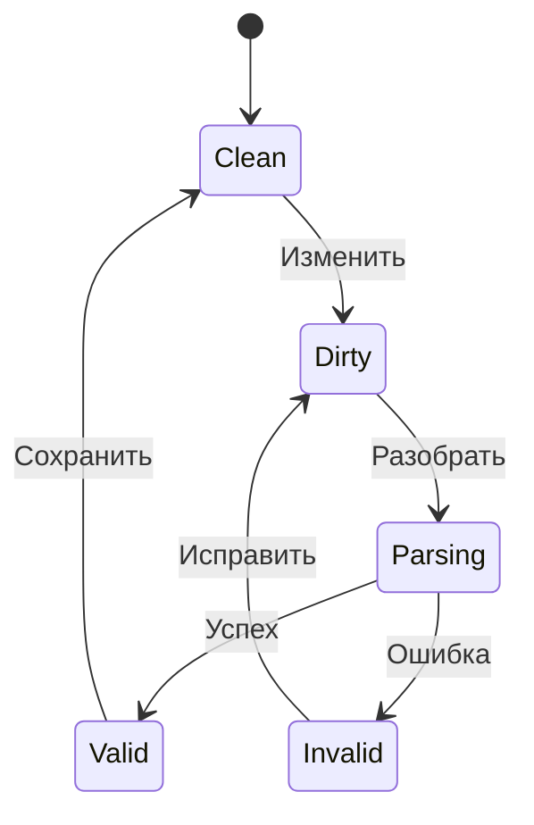
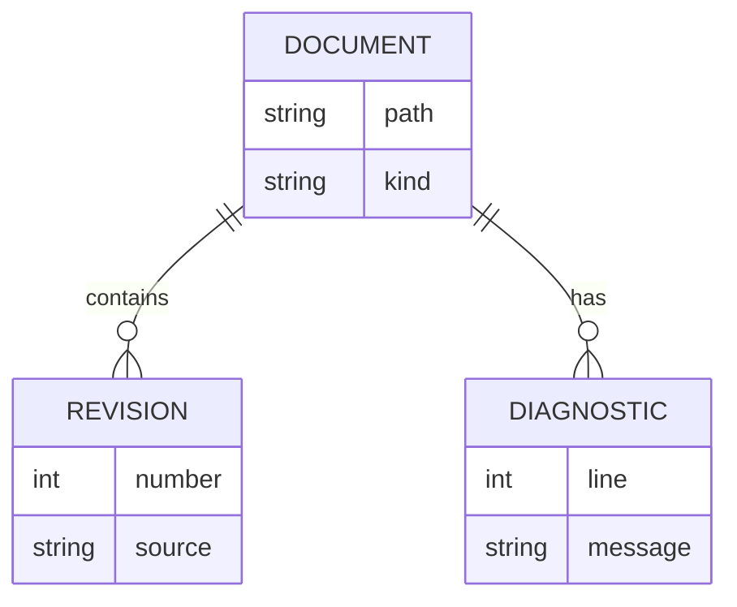
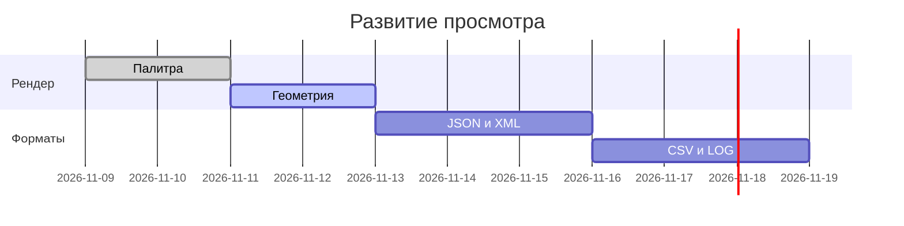
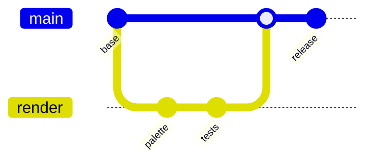
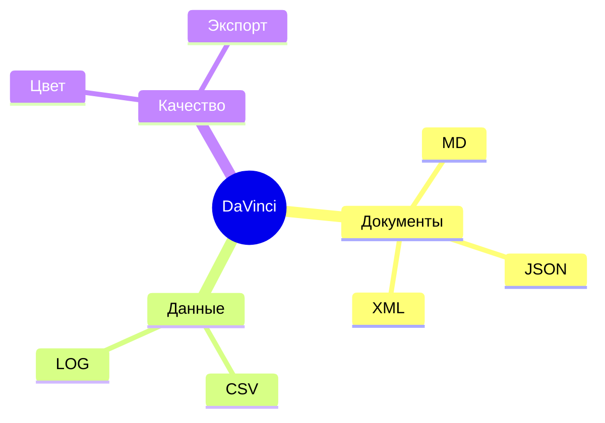
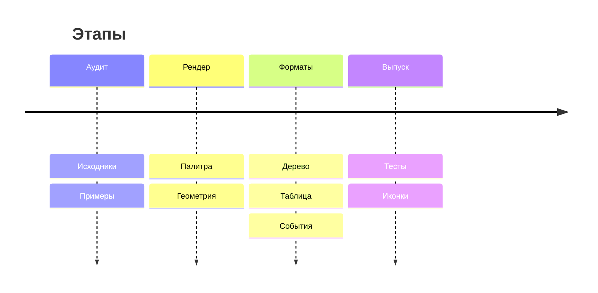
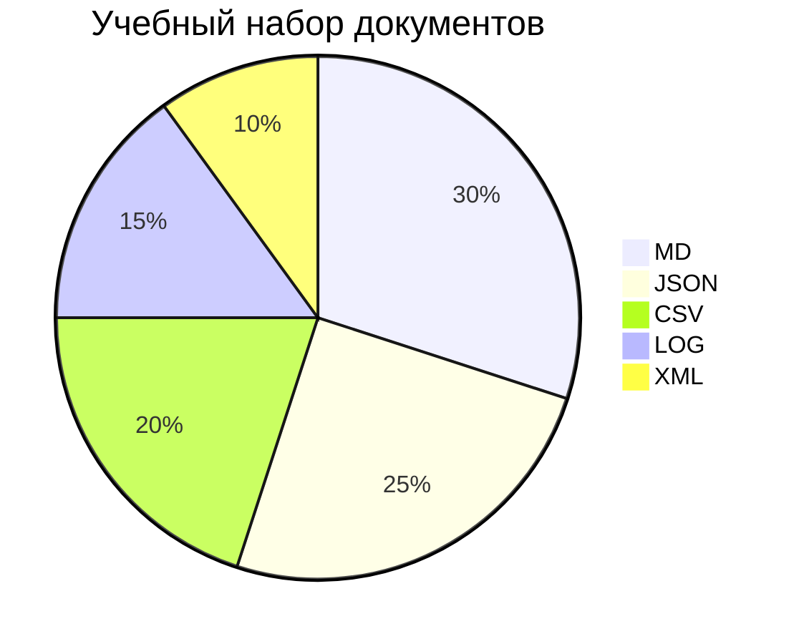

# Примеры Mermaid

Исходники для проверки на установленной версии Mermaid. Автоматическое выполнение в этом комплекте не проводилось.

## Цветной процесс

## Повтор схемы — проверка уникальных ID

## Последовательность

## Классы

## Состояния

## Связи данных

## План

## Ветки

## Карта

## Этапы

## Распределение

