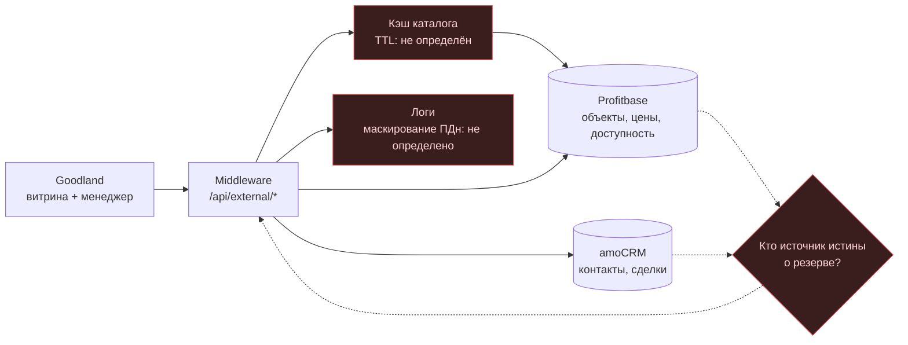
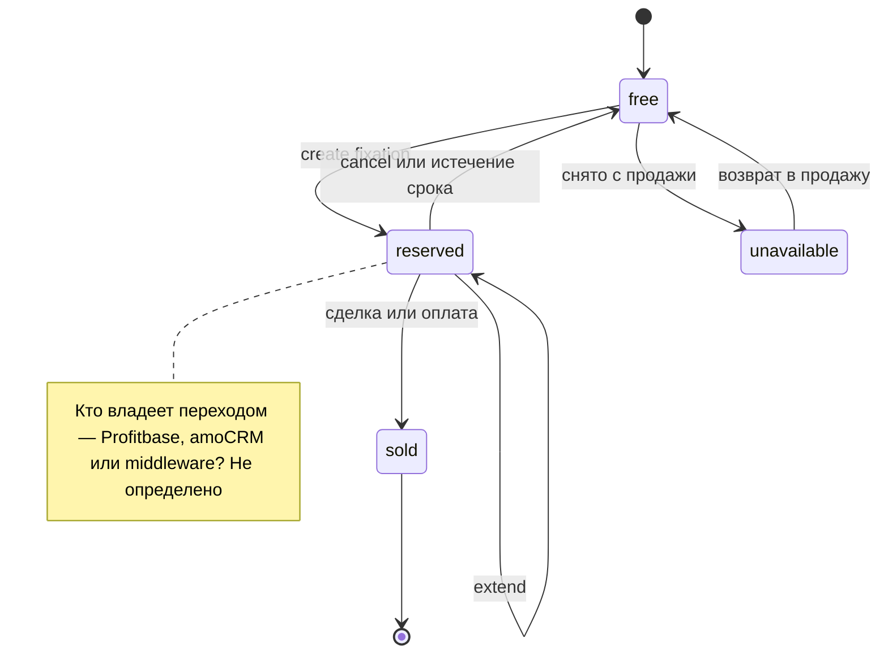

# ТЗ: рендер Mermaid — два исходника

Схемы из `DaVinci_Mermaid_Render_TZ.md` §4. Используются Render Lab для приёмки
геометрии, маршрутов и подписей.

## A. Интеграция Goodland

## B. Состояния резерва

