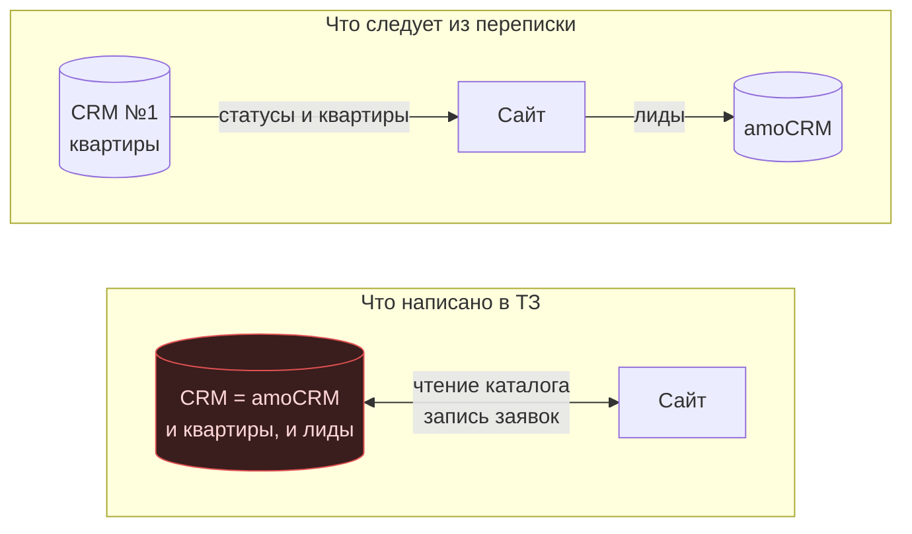
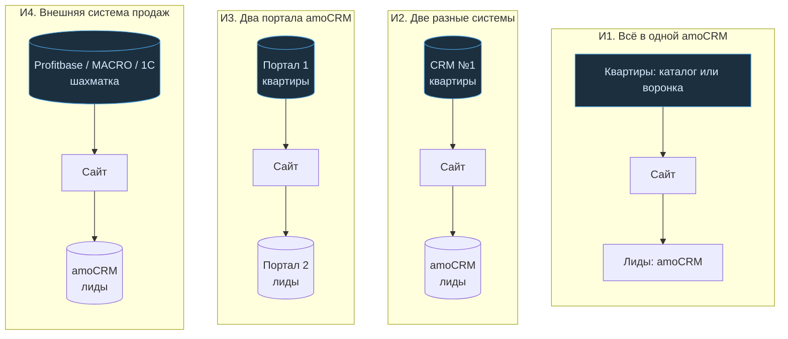

# Clustered flowcharts (Mermaid subgraph)

Two diagrams from the customer document where clusters are drawn by Mermaid
itself. The orthogonal router must leave them exactly as rendered.

## 3.2. Two clusters with a dashed separator

## 3.3. Four clusters, one per configuration

